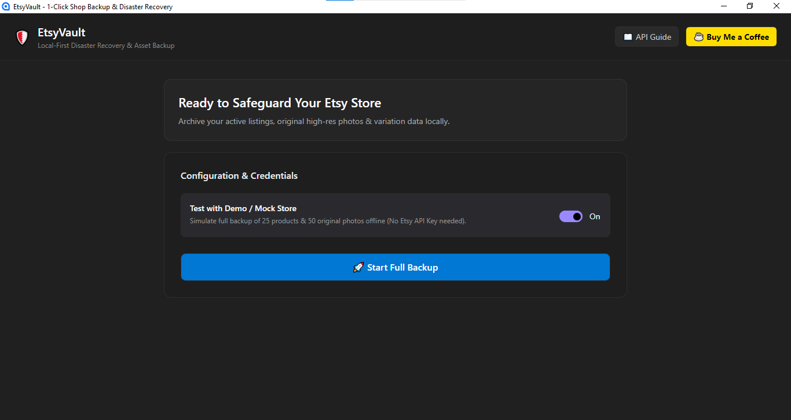
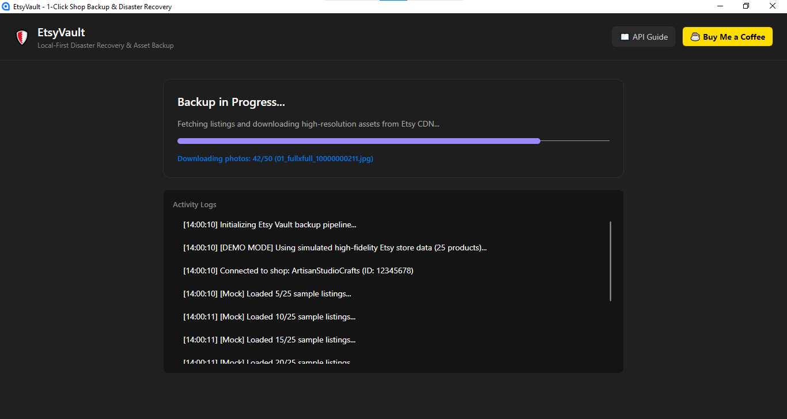
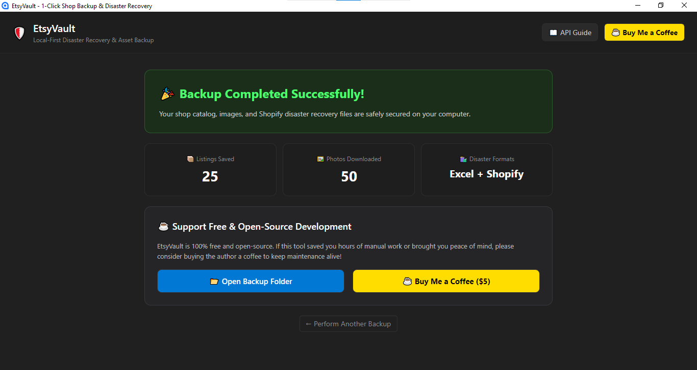
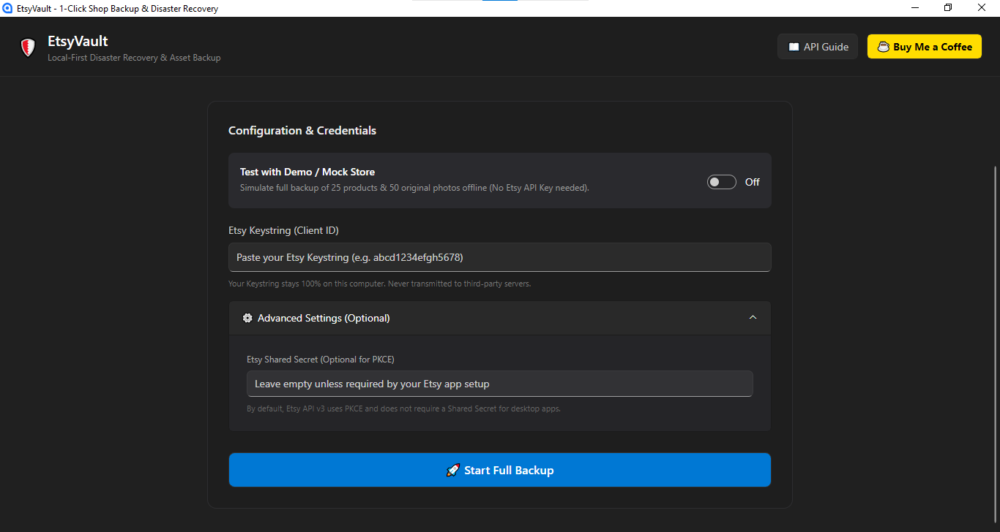

# 🛡️ EtsyVault

> **Open-source, local-first backup & disaster recovery tool for Etsy sellers.**  
> Built strictly against the **[Official Etsy OpenAPI 3.0 Specification](https://www.etsy.com/openapi/generated/oas/3.0.0.json)**.

---

## ⚡ Why EtsyVault?

Etsy account suspensions happen unexpectedly, and sellers frequently lose years of optimized titles, descriptions, variation matrices, and high-resolution product photography.

**EtsyVault** safeguards your business:
- 📦 **1-Click Full Backup:** Archives all listings, tags, materials, inventory, and SKU data.
- 🖼️ **Original Resolution Images:** Downloads original full-size product photos straight to organized folders.
- 🛍️ **Disaster Recovery Ready:** Automatically exports ready-to-import **Shopify CSV** and comprehensive **Excel sheets**.
- 🔒 **100% Private & Local:** Runs completely on your device. Zero external cloud servers, zero telemetry.
- ⏱️ **Safe Throttling:** Strict Leaky-Bucket rate limiting (~2.5 QPS) to strictly prevent Etsy API quota exhaustion.

---

## 📸 Screenshots

| 1. Ready & Demo Mode | 2. API Credentials & Advanced Settings |
| :---: | :---: |
|  |  |
| **3. Realtime Concurrency Logs & Progress** | **4. Backup Complete & Disaster Recovery** |
|  |  |

---

## 🔄 How Does EtsyVault Connect to Your Shop?

You might wonder: *“How does the app know which shop to download just from a Keystring?”*

Here is the simple, 100% private 4-step connection process:

1. **You are already logged into Etsy:** You keep your shop account signed in on your normal web browser (Chrome, Safari, Edge).
2. **Enter your Keystring & Click Start:** The app opens your browser to Etsy’s official authorization page (`https://www.etsy.com/oauth/connect`).
3. **One-Click Authorization:** Because your browser already knows who you are, you simply click **"Grant Access"**. Etsy securely issues a temporary access token directly to the app running on your machine.
4. **Auto-Discovery of Your Shop (`/users/me/shops`):** The app calls Etsy’s official endpoint to ask: *“Which shop belongs to this logged-in seller?”*. Etsy instantly returns your exact `shop_id`, and the app immediately begins archiving your listings and original high-resolution photos!

> 🔒 **Zero Configuration & Zero Risk:** You never need to look up your internal Shop ID manually. No passwords or secret keys are ever shared with any third party.

---

## 🚀 Quick Start

1. Download the latest release for your platform from the [Releases](https://github.com/thieuhoang2002/EtsyVault/releases) page (**Windows `.exe`** and **macOS Apple Silicon / Intel**).
2. Follow our [2-Minute Free Etsy API Key Setup Guide](docs/how-to-get-etsy-api-key.md).
3. Open `EtsyVault`, paste your Keystring, and click **🚀 Start Full Backup**!

*(Having trouble opening the app on Windows or Mac? See [Bypassing OS Warnings](docs/os-security-warnings.md).)*

---

## 🛠️ Tech Stack & Architecture

- **Runtime:** .NET 10 SDK
- **UI Framework:** AvaloniaUI 12 + FluentAvalonia (Modern Windows 11 Fluent Design)
- **Architecture:** Clean MVVM (`CommunityToolkit.Mvvm`)
- **Excel/CSV Engine:** MiniExcel (High-throughput streaming)
- **Concurrency:** `System.Threading.Channels` for parallel multi-worker image downloads
- **Security:** RFC 7636 OAuth 2.0 PKCE authentication with local loopback listener

👉 **For comprehensive technical diagrams, OAuth sequence flows, and concurrency pipeline analysis, see [System Architecture & Engineering Deep-Dive](docs/architecture.md).**

---

## ☕ Support the Project

EtsyVault is free and open-source. If this tool brought you peace of mind or saved hours of work, consider supporting development:

You can also support via **[Ko-fi](https://ko-fi.com/thhoang0903)** or **[PayPal](https://paypal.me/thieuhoang2209)**.

---

## 🌐 Looking to Scale Your Etsy Operations & Sales?

While **EtsyVault** specializes in local asset backup and disaster recovery, check out our companion web platform:

👉 **[Etsy Command Center](https://etsy.thhoang.io.vn)** — *All-in-One Operations, Finance & Automation Suite*
- 🎯 **Competitor Radar & Sales Delta:** Track real-time listing sales velocities and discover untapped niches.
- 🛡️ **Trademark Shield:** Automated keyword risk scanning to protect listings against IP strikes.
- 📈 **Net P&L Calculator:** Precise profit breakdown accounting for Etsy transaction fees, VAT, and ad spend.
- 🔑 **Zero-Knowledge E2EE Vault:** Bank-grade client-side encryption for secure operations.

---

## 📄 License

Distributed under the MIT License. See `LICENSE` for more information.
