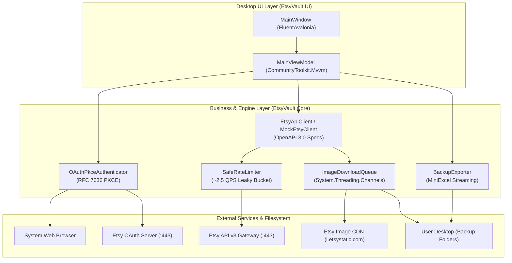
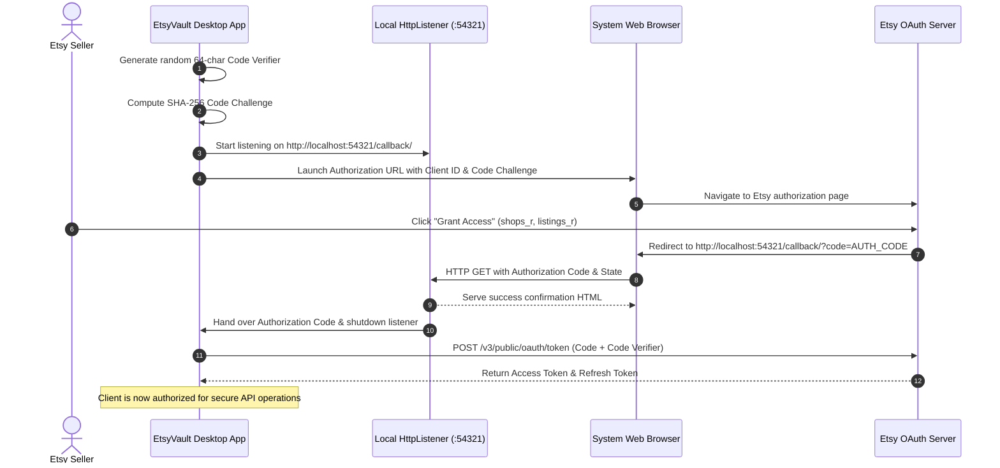

# 🏛️ EtsyVault System Architecture & Engineering Deep-Dive

> Comprehensive technical documentation detailing the internal design, concurrency pipeline, throttling algorithms, and OAuth 2.0 PKCE authentication flow of **EtsyVault**.

---

## 1. High-Level Architecture Overview

EtsyVault is engineered following the **Clean Architecture** and **Model-View-ViewModel (MVVM)** design patterns. The codebase is decoupled into two primary assemblies:

1. **`EtsyVault.Core` (NetCore Library):** Contains pure business logic, the Etsy OpenAPI v3 client wrapper, cryptographically secure PKCE authentication, the token-bucket rate limiter, parallel image streaming channels, and MiniExcel export pipelines.
2. **`EtsyVault.UI` (Avalonia Application):** Cross-platform desktop interface powered by **AvaloniaUI 12** and **FluentAvaloniaUI**, providing native Windows 11 Fluent UX and macOS support.



---

## 2. OAuth 2.0 PKCE Authentication Workflow

Because desktop applications cannot securely conceal a client secret, EtsyVault implements **PKCE (Proof Key for Code Exchange - RFC 7636)**. This guarantees full end-to-end security without requiring intermediary cloud servers.



---

## 3. High-Throughput Concurrency & Throttling Algorithm

### A. Strict Leaky Bucket Rate Limiting (~2.5 QPS)
Etsy grants **Personal Access** tier apps a quota of 5 Queries Per Second (QPS) and 5,000 Queries Per Day (QPD). To avoid `HTTP 429 Too Many Requests` penalties caused by network jitter:
- The rate limiter enforces a conservative target of **~2.5 QPS (minimum 400ms inter-request interval)**.
- Synchronization is handled via non-blocking asynchronous `SemaphoreSlim(1, 1)`.

### B. Producer-Consumer Image Download Pipeline
Fetching high-resolution product imagery uses `System.Threading.Channels` with bounded capacity, achieving $O(1)$ enqueue/dequeue complexity:
- **Producer (Single-threaded API crawler):** Traverses listings within rate limits and deposits image download jobs into the Channel.
- **Consumers (Multi-worker pool):** 4 concurrent workers consume jobs and download full-resolution binaries directly from Etsy's static CDN (`i.etsystatic.com`). Because CDN downloads do not count against the API's 5 QPS rate limit, photos download at wire speed.

```mermaid
flowchart LR
    API["Etsy API v3<br/>(Rate Limited ~2.5 QPS)"] -->|Resolve URLs| Producer["Producer Thread"]
    Producer -->|Enqueue Job O(1)| Channel[("Bounded In-Memory Channel")]
    
    Channel -->|Dequeue| Worker1["Worker 1"]
    Channel -->|Dequeue| Worker2["Worker 2"]
    Channel -->|Dequeue| Worker3["Worker 3"]
    Channel -->|Dequeue| Worker4["Worker 4"]
    
    Worker1 -->|Download Binary| CDN["Etsy CDN"]
    Worker2 -->|Download Binary| CDN
    Worker3 -->|Download Binary| CDN
    Worker4 -->|Download Binary| CDN

    Worker1 -->|Write Stream| Disk["Desktop Backup Folder"]
    Worker2 -->|Write Stream| Disk
    Worker3 -->|Write Stream| Disk
    Worker4 -->|Write Stream| Disk
```

---

## 4. Disaster Recovery & Streaming Serialization

To prevent high-memory pressure (`OutOfMemoryException`) when handling stores with thousands of listings:
1. **Streaming Master Excel Sheet (`Products_Master.xlsx`):** Uses `MiniExcel` to stream rows directly to disk via `IEnumerable`, maintaining $O(1)$ memory overhead.
2. **Shopify-Ready Migration CSV (`Shopify_Ready_Import.csv`):** Automatically maps Etsy tags, variation matrices, HTML-formatted descriptions, and inventory quantities to Shopify’s official import schema for immediate store re-platforming.
3. **JSON Snapshot (`Backup_Snapshot.json`):** Writes full raw metadata using asynchronous `System.Text.Json` streaming.

---

## 5. Security & Privacy Guarantees

- **Zero Cloud Middlemen:** All network connections are opened strictly between the local computer and official Etsy endpoints (`api.etsy.com`, `etsystatic.com`).
- **Zero Telemetry:** No user analytics, metrics, or personal shop data are ever collected or transmitted.
- **Cryptographic Rigor:** PKCE verifiers are generated using `System.Security.Cryptography.RandomNumberGenerator` to eliminate predictable pseudo-random vulnerabilities.
